# Firmware Liberator
**Sonoff eWeLink → Tasmota, OpenBeken, ESPHome**
> **Firmware Flasher Tool**  
(Over The Air - Flash over Wi-Fi - 'OTA')

<br>

[](#what-you-need)

[](#what-you-end-up-with) [](#what-you-end-up-with) [](#what-you-end-up-with)

[](https://github.com/adamsthws/firmware-liberator/releases/latest) [](https://github.com/adamsthws/firmware-liberator/actions/workflows/emulator-check.yml) [](LICENSE)

[%20total&replace=%241&label=Discussions&color=blue)](https://github.com/adamsthws/firmware-liberator/discussions) [%20open&replace=%241&label=Issues&color=blue)](https://github.com/adamsthws/firmware-liberator/issues) [%20open&replace=%241&label=Pull%20Requests&color=blue)](https://github.com/adamsthws/firmware-liberator/pulls) [](https://github.com/adamsthws/firmware-liberator/releases)

<br>

### Keep this tool alive and growing  
Your kind donation goes toward expansion, supporting many more devices - Thankyou!  


[](https://github.com/sponsors/adamsthws) [](https://ko-fi.com/adamsthws) [](https://www.paypal.me/adamsthws)  

> Bonus: Sponsor through GitHub and you earn the coveted Sponsor achievement on your profile: 

<br>

## Liberation From The Cloud

Your device answers to you alone, on your own network.
> Removes dependence on external cloud servers. After flashing you'll no longer require a cloud account or third party app - your device will be truely local and fully under your control.

<br>

### Fully automated 'Over The Air' firmware conversion

Turn your Sonoff device into one running **ESPHome**, **Tasmota** or **OpenBeken**, using OTA method - no soldering, no taking the device apart.

> Conversion with this tool is fully automated end to end, with checks at every stage. It is resumable and can be restarted at any point.

<br>

### Any Direction

And every route between them.
> Stock Sonoff to Tasmota, OpenBeken or ESPHome, either to the other, and back to Sonoff's own firmware if you change your mind.

<br>


<br>

### No More Soldering

Until now, the established way to flash a device was to open it, perform some soldering and flash it over USB-serial - hard work, because the case is often plastic-welded shut.

> The community threads for the soldering method: [S60, UK version](https://github.com/arendst/Tasmota/discussions/22554) & [S60, EU version](https://github.com/arendst/Tasmota/discussions/21255).

<br>

### What you need

- **An eWeLink account**
> A throwaway one is fine.  
> (The device has to be added to eWeLink first).

- **A computer**
> Linux, macOS or Windows, with Wi-Fi.

- **Admin rights**
> Needed to add one temporary firewall rule.  
> (Done automatically and removed when the tool finishes).

- **A supported device**
> More coming soon: **[get an email as more devices are supported](https://firmwareliberator.com/notify)**.  
> **[How you can help](#how-you-can-help)**: if your Sonoff isn't listed, the tool can read it out and send it in, so support for it can be added.

| Status | Device | Models |
|---|---|---|
| [](devices/sonoff-s60/README.md) | [Sonoff S60](devices/sonoff-s60/README.md) | S60TPG (UK, Type G), S60TPF (EU, Type E/F) |
| [](devices/sonoff-s61/README.md) | [Sonoff S61](devices/sonoff-s61/README.md) | S61STPF (EU, Type E/F) |
| [](devices/sonoff-pow-elite/README.md) | [Sonoff POW Elite 16A](devices/sonoff-pow-elite/README.md) | POWR316D |
| [](devices/sonoff-powct/README.md) | [Sonoff POW Ring](devices/sonoff-powct/README.md) | POWCT |
| [](devices/sonoff-th-elite/README.md) | [Sonoff TH Elite 20A](devices/sonoff-th-elite/README.md) | THR320D |
| [](devices/sonoff-dualr3/README.md) | [Sonoff Dual R3](devices/sonoff-dualr3/README.md) | DUALR3, DUALR3 Lite |
| [](devices/sonoff-basic-1gs/README.md) | [Sonoff Basic Gen5](devices/sonoff-basic-1gs/README.md) | BASIC-1GS |
| [](devices/sonoff-nspanel/README.md) | [Sonoff NSPanel](devices/sonoff-nspanel/README.md) | NSPanel |
| [](devices/sonoff-basicr4/README.md) | [Sonoff BASICR4](devices/sonoff-basicr4/README.md) | BASICR4 |
| [](devices/sonoff-minir4/README.md) | [Sonoff MINI Extreme](devices/sonoff-minir4/README.md) | MINIR4 |
| [](devices/sonoff-m5-1c/README.md) | [Sonoff M5 1-gang](devices/sonoff-m5-1c/README.md) | M5-1C |
| [](devices/sonoff-m5-2c/README.md) | [Sonoff M5 2-gang](devices/sonoff-m5-2c/README.md) | M5-2C |
| [](devices/sonoff-m5-3c/README.md) | [Sonoff M5 3-gang](devices/sonoff-m5-3c/README.md) | M5-3C |

> **Supported** = A real one has been converted and reported.

> **Testers wanted** = Converts in the emulator, or is added from its official file and a published pin map; no real one reported yet.

> **Readout wanted** = Not converted yet, but [a readout](docs/readouts.md) of one would help add it, and is proven in the emulator to leave it as it was.

> **Not supported yet** = The tool does not convert it yet; a readout of one sends only what Sonoff's own firmware and eWeLink say. See [devices/](devices/README.md).

<br>

## Let's go

Simply paste this one line into your terminal to get started...

>You're walked through every step of the conversion.

<br>

**Linux**
```sh
sh -c "$(wget -qO- https://github.com/adamsthws/firmware-liberator/releases/latest/download/liberate.sh)"
```
> <details>
> <summary>If you see: <code>wget: not found</code></summary>
>
> > Use the macOS line instead: the only difference being that it uses `curl` in place of `wget` to fetch your download.
> </details>

<br>

**Windows**
```
powershell -c "irm https://github.com/adamsthws/firmware-liberator/releases/latest/download/liberate.ps1 | iex"
```
> <details>
> <summary>If you see: <code>running scripts is disabled</code></summary>
>
> > A policy on your computer may be preventing scripts from running.
> > Your two options are:
> > - Use a different computer (i.e, one without a restrictive company policy enabled).
> > - Lift the policy while you convert, then put it back afterward.
> > To check that, run: `Get-ExecutionPolicy -List`. If it shows `MachinePolicy` or `UserPolicy` set to something other than `Undefined`, do the following...
> >
> > Open PowerShell as administrator and run this. It saves a copy of the policy in your user folder first, so it can be put back exactly:
> >
> > ```powershell
> > foreach ($k in "HKLM", "HKCU") { $p = "${k}:\SOFTWARE\Policies\Microsoft\Windows\PowerShell"; if (Test-Path $p) { reg export "$k\SOFTWARE\Policies\Microsoft\Windows\PowerShell" "$HOME\$k-powershell-policy.reg" /y | Out-Null; Set-ItemProperty $p ExecutionPolicy Bypass; Set-ItemProperty $p EnableScripts 1 -Type DWord } }
> > ```
> >
> > Run the liberator again. When the conversion is done, put the policy back as it was:
> >
> > ```powershell
> > foreach ($k in "HKLM", "HKCU") { $f = "$HOME\$k-powershell-policy.reg"; if (Test-Path $f) { Remove-Item -Recurse "${k}:\SOFTWARE\Policies\Microsoft\Windows\PowerShell"; reg import $f 2>$null; Remove-Item $f } }
> > ```
> </details>

<br>

**macOS**
```sh
sh -c "$(curl -fsSL https://github.com/adamsthws/firmware-liberator/releases/latest/download/liberate.sh)"
```

<br>
<br>

> **Alternative download method**
>
> <details>
> <summary>Get it with git or download it as a zip</summary>
>
> > ```sh
> > git clone https://github.com/adamsthws/firmware-liberator.git
> > cd firmware-liberator
> > sh start.sh       # Linux / macOS
> > .\start.cmd       # Windows
> > ```
> >
> > -- or -- [download as a zip](https://github.com/adamsthws/firmware-liberator/archive/refs/heads/main.zip)
> </details>

<br>

### What you'll see

**Tasmota:**



**ESPHome:**



<br>

### If you have to stop

E.g. you close the window, lose your Wi-Fi, run out of time - it doesn't matter. Run the
same command again - the one line above, or `start.cmd` / `sh start.sh` in the folder.

> It remembers which device it was working on and what it had done. Where a step
was interrupted, it checks the device to work out where to resume from.

<br>

### What you end up with

**Official:**  
[ESPHome](https://github.com/esphome/esphome) - or - [Tasmota](https://github.com/arendst/tasmota) - or - [OpenBeken](https://github.com/openshwprojects/OpenBK7231T_App)  - (Your choice)
  
\- and -

- A full backup of the device's Sonoff firmware to restore later.

- Once flashed, ESPHome, Tasmota and OpenBeken recieve thier updates as normal.

- Converted devices are identical to ones flashed over USB.
> The final automated checks verify this by hashing at the end of the conversion. (Every block and every byte is verified).

<br>

### If something goes wrong

Start with **[troubleshooting](docs/troubleshooting.md)**
> It covers the problems that came up while the tool was being built.

<br>

### How it went

See how it has gone for others: **[Stats](https://firmwareliberator.com/stats)**
> How many devices the tool has converted, and how reliably, device by device.

<br>

### How you can help

**Got a Sonoff that isn't listed?** A firmware readout of it is the quickest way to get support for it added.

Run the tool as usual. When it finds no supported device in your eWeLink account, it offers to **read-out your device to help add support for it**. If you have several devices, you can choose to read them all out at once.
> To read out a device that is already listed (another version of its firmware, say), run `sh start.sh readout`, or `start.cmd readout` on Windows, in the tool's folder.

What a firmware readout does:
- To read the whole memory, it may install a small program in place of the device's firmware for a few minutes, then put the device's own Sonoff firmware, settings and eWeLink pairing back. On some devices it sends nothing at all, and the readout is only what the device reports.
- The tool has never run on your kind of device. If the small program could not start at all, the device may need a serial cable to recover. Only go ahead with a device you can afford to lose.

What is sent, once you agree:
- **The device's firmware readout, anonymised.** It is kept privately, never published, and used only to add support for the device.
- What the device and eWeLink said it is, and the tool's version.
- If you choose to add it, your email address, so you can be told when support for your device changes. You confirm it first, from an email sent to it. You can leave it even when no readout of your device is needed: one like it may be in already.
> A copy also stays on your computer, beside your other Sonoff backups.

<br>

## Documentation

- **[what-happens](docs/what-happens.md)** - how it works and what
  happens to the device, step by step.
- **[technical-details](docs/technical-details.md)** - the firmware
  bundle, secrets handling, memory layout, technical notes.
- **[troubleshooting](docs/troubleshooting.md)** - problems met so far
  and their fixes.
- **[emulator](docs/emulator.md)** - the whole conversion run against
  an emulated device.
- **[unattended](docs/unattended.md)** - running a conversion with
  nobody at the keyboard - for testing.
- **[testing](docs/testing.md)** - unit tests, the emulator, fault injection, and real devices.
- **[updating-firmware](docs/updating-firmware.md)** - how the
  Tasmota and ESPHome the tool installs are updated.
- **[readouts](docs/readouts.md)** - what a readout of a device holds, and
  where it goes.
- **[what-the-tool-sends](docs/what-the-tool-sends.md)** - the report each
  run sends, what it is used for, and how to turn it off.
- **[upstream-contributions](docs/upstream-contributions.md)** - bugs
  found and fixed while building this project.
- **[legal](docs/legal.md)** - how the project remains lawful, and what it asks of you.
- **[privacy](docs/privacy.md)** - who keeps your email address, if you sign up, and your rights.

<br>

## Roadmap

This project has big ambitions to support a broad range of devices and firmwares. The difficult groundwork has been laid down
to support devices built on both **Espressif** and **Beken** chips. Next is expanding the list of supported devices.

> Also being considered: support for **Supla** firmware, **Zamel** modules and **Tuya** devices.

<br>

## Thanks

Thanks too to everyone in the Tasmota threads for the
[UK](https://github.com/arendst/Tasmota/discussions/22554) and
[EU](https://github.com/arendst/Tasmota/discussions/21255) S60, whose
open-the-case method came first.

A big thank you to [HG0161](https://github.com/HG0161) and the
[SonoffS60OTA](https://github.com/HG0161/SonoffS60OTA) repository for working out the OTA update mechanism (Worked out with the Tasmota community's discussion of this device).

Thanks to [lcgamboa](https://github.com/lcgamboa) for the
[QEMU fork](https://github.com/lcgamboa/qemu) that emulates the ESP32, and to [openshwprojects](https://github.com/openshwprojects) for the
[Beken emulator](https://github.com/openshwprojects/BekenEmulator). Every conversion is tested against them before it reaches a real device.

Thanks to [p1otr](https://github.com/p1otr) for the ESPHome option and its
S60 config.

<br>

### To Sonoff and eWeLink

Thankyou for making such excellent devices. Please keep this update method open. Letting owners run their own firmware is a win for you as much as for them.

**It sells devices**
> Tasmota began life as *Sonoff-Tasmota*: a great many people first bought Sonoff because they could reflash it, and the home-automation community still recommends the brand for that reason. Every device this tool supports is one more reason to choose Sonoff over an alternative.

**It costs you less**
> A converted device never calls your servers. You keep the sale and drop the years of cloud traffic, accounts and app support that would have come with it. Sell more, support less.

**The owners support themselves**
> Someone who installs their own firmware takes on its upkeep. Tasmota, ESPHome and OpenBeken are maintained by their own communities.

<br>

## At your own risk

You use this tool at your own risk. Changing a device's firmware can go wrong for reasons nobody controls - a power cut, a weak Wi-Fi signal, a device that differs from the ones it was tried on - and can leave a device that has to be opened and repaired with a serial cable, or one that cannot be repaired at all. Changing its firmware may also end its maker's warranty.

The tool is provided as it is, with no warranty of any kind. Nobody who made it or contributed to it accepts responsibility for any harm to your devices, property or data, or any other loss, however it comes about. Sections 15 and 16 of its [licence](LICENSE), the GNU GPL v3, say so in full.

Only go ahead with a device you can afford to lose.
